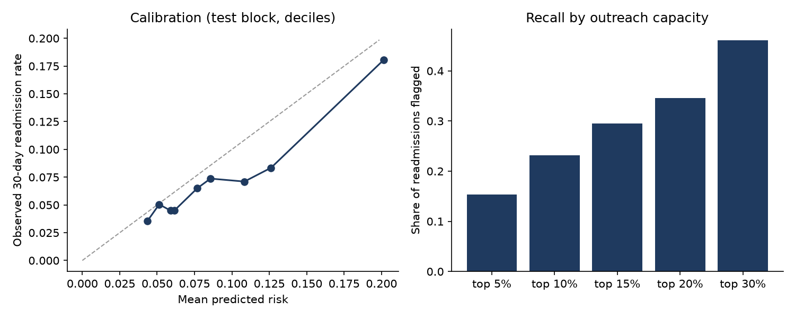

# 30-day readmission risk: from noisy EHR extract to a scoring service

An end-to-end MVP of a hospital predictive-analytics product: it validates and cleans a
messy clinical extract, trains and calibrates a model, evaluates it the way an
operations team would use it, audits it across patient subgroups, checks for drift,
and serves scores through a containerised API.

**Data:** UCI *Diabetes 130-US Hospitals, 1999–2008*: 101,766 de-identified inpatient
encounters, public under CC BY 4.0 ([dataset 296](https://archive.ics.uci.edu/dataset/296)).
**Task:** at discharge, estimate each adult diabetic patient's risk of readmission
within 30 days, so a transitional-care team can decide whom to call first.

## Results

Cohort: 69,987 patients (first encounter each, after excluding deaths and hospice
discharges); 9.0% readmitted within 30 days. Held-out test block = latest 13,998
encounters. Full report: [docs/REPORT.md](docs/REPORT.md).

| Test block (latest encounters) | Value (95% bootstrap CI) |
|---|---|
| AUROC | 0.630 (0.611–0.649) |
| AUPRC | 0.126 (0.111–0.145), vs. prevalence 0.067 |
| Brier score | 0.062 (0.058–0.065) |
| Top 5% of discharges flagged | 21% readmitted, 3.1× the base rate |
| Top 10% of discharges flagged | catches 23% of readmissions, 2.3× lift |



### What the results show

1. **Useful for prioritising, not for diagnosing.** Discrimination is modest, as
   expected from administrative data, but the highest-risk 5% are readmitted at
   three times the base rate. With the placeholder costs, net value per 1,000
   discharges peaks when the team reaches about the top 15%.
2. **The strongest signals are discharge destination and prior inpatient stays,**
   followed by primary diagnosis group and number of diagnoses.
3. **Calibration drifts over time.** The readmission rate falls from earlier to
   later encounters (6.7% in the test block), so a model calibrated on earlier data
   over-predicts: mean predicted risk is about 8.5%. In a real deployment I would
   recalibrate on the most recent months before go-live and monitor calibration
   monthly.
4. **Documentation changed under the model.** Payer code and medical specialty were
   recorded very differently in later encounters (PSI 0.98 and 0.73). Shifts like
   this usually come from upstream workflow or EHR changes, and the drift check
   catches them before they quietly degrade a model.
5. **Performance is not even across groups.** AUROC is 0.56 for African American
   patients versus 0.64 for Caucasian patients, and recall at the top-10% threshold
   is 0.14 versus 0.32. Patients aged 90+ are also under-flagged. Before any use I
   would review this with clinical partners, check features and calibration per
   group, and agree on acceptable thresholds.

## What the pipeline does

```
raw CSV ─► validate ─► clean ─► features ─► train 2 models ─► select ─► calibrate ─► evaluate ─► report
             │            │                                              │
       schema / range   first encounter per patient,              model.joblib + model_card.json
       checks fail fast  drop expired/hospice, "?"→Unknown                │
                                                                     FastAPI /score (Docker)
```

| Step | Choice and why |
|---|---|
| **Validation** (`data.py`) | Required columns, unique IDs, numeric ranges and allowed target values are checked before anything is trained. A bad extract stops the run with a readable error. |
| **Cohort** | One row per patient (first encounter) so no patient is in both train and test. Encounters ending in death or hospice are removed, because readmission can't happen. |
| **Split** | Ordered by encounter ID (the public data has no dates): train on the earliest 60%, calibrate on the next 20%, test on the latest 20%. This mimics prospective validation better than a random split. |
| **Features** (`features.py`) | ICD-9 codes grouped into clinical categories, prior utilisation, medication changes, A1c and glucose testing, admission and discharge context. Race and gender are **not** inputs; they are used only for the audit. |
| **Models** (`train.py`) | Logistic regression baseline vs. gradient boosting (scikit-learn). The winner on the validation block is calibrated with isotonic regression so a score of 0.2 means about a 20% risk. |
| **Evaluation** (`evaluate.py`) | AUROC, AUPRC, Brier with bootstrap CIs; decile calibration; permutation importance. |
| **Operational view** | For a team that can reach the top 5–30% of discharges: precision, recall, lift, number needed to contact, and net value per 1,000 discharges. Cost and effectiveness figures are labelled **placeholders** in one dataclass, to be replaced with the hospital's own numbers. |
| **Subgroup audit** | AUROC, calibration-in-the-large, flag rate and recall by race, gender and age at one shared threshold. |
| **Monitoring** (`monitor.py`) | Population stability index for every input and for the risk score, with stable / watch / investigate bands. |
| **Serving** (`api.py`) | FastAPI with typed input validation, `/health`, `/model-card` and batch `/score`. The model version is in every response. |
| **Engineering** | 19 pytest tests (validation rules, leakage-free split, ICD-9 mapping, drift detection, API contract, end-to-end run), GitHub Actions CI, Dockerfile, Makefile. Tests run on synthetic data with the same schema, so CI never needs the real file. |

## Run it

```bash
make install
make test          # ~10 s, synthetic data
make train         # downloads the UCI file, writes artifacts/
make serve         # http://localhost:8000/docs
make docker        # build and run the API container
```

```bash
curl -X POST localhost:8000/score -H 'Content-Type: application/json' -d '{
  "encounters": [{"encounter_id": 1, "age": "[70-80)", "time_in_hospital": 6,
                  "number_inpatient": 2, "diag_1": "428", "discharge_disposition_id": "3",
                  "medications": {"insulin": "Up"}}]}'
```

## What I would do next in a real deployment

1. **Retrain on current local EHR data** (Epic Clarity/Caboodle or OMOP), with real
   admission dates for a true temporal split.
2. **Silent prospective run** for 4–8 weeks: score live discharges without showing
   them, then compare predictions with observed readmissions before go-live.
3. **Agree the threshold with the care team** from the capacity table, not from a
   default cut-off.
4. **Adoption metrics**: share of flagged patients contacted, time to contact, and
   readmission rate in contacted vs. similar uncontacted patients.
5. **Scheduled drift and subgroup checks**, with a retraining trigger when the score's
   PSI goes above 0.25 or calibration slips.
6. **Scale the feature step** to Spark if the extract grows past one machine.

## Limitations

The data is from 1999–2008 and covers diabetic inpatients only. Readmissions to other
hospitals aren't captured. Encounter order is only a proxy for time. The ROI figures
depend entirely on the placeholder assumptions. This is a demonstration, not a
clinical tool.

---
Ankita Singh, Ph.D. · [Google Scholar](https://scholar.google.com/citations?user=xRtUSq0AAAAJ) · [LinkedIn](https://www.linkedin.com/in/ankitasingh1292)
