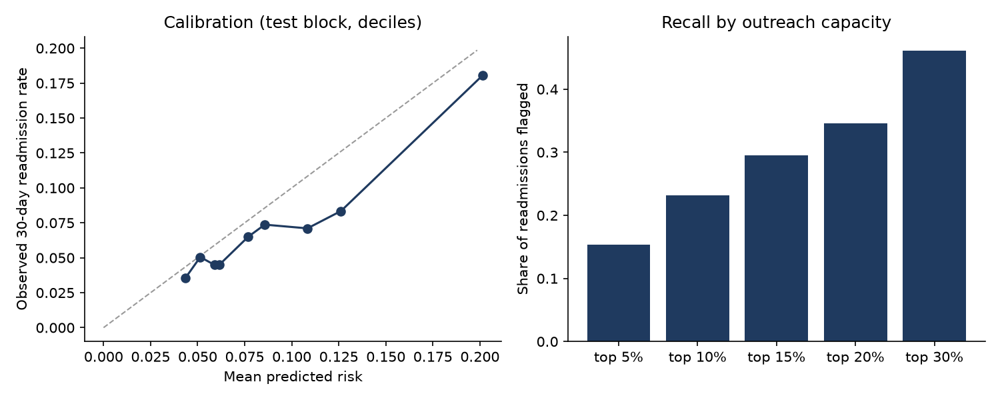

# Readmission risk: results of this run

## In short

The model ranks a readmitted patient above a non-readmitted one 63% of the time (50% would be a coin flip). If a care team called the top 10% of patients by risk score, it would reach 23% of the patients who came back within 30 days.

## The patients

- Hospital stays in the file: 101,766
- Removed because the patient died or went to hospice: 2,423
- Removed as repeat visits by the same patient (I kept each patient's first visit): 29,353
- Removed because sex was not recorded: 3
- Patients left: 69,987, of whom 9.0% came back within 30 days
- The earliest 41,992 visits were used to train the model, the next 13,997 to fine-tune it, and the most recent 13,998 to test it.

## Choosing a model

I tried two models and kept the one that ranked patients better on the fine-tuning set.

| Model | Ranking score (AUROC) |
|---|---|
| logistic regression | 0.635 |
| gradient-boosted trees (kept) | 0.640 |

## How well it did on the most recent patients

- **Ranking score (AUROC): 0.630**, likely between 0.611 and 0.649. This is the chance the model scores a readmitted patient higher than one who wasn't readmitted.
- **Readmission rate in this group: 6.7%.**
- **Average error of the risk estimates (Brier score): 0.062.** Lower is better.

The left chart compares the model's predicted risk with what actually happened. Points on the dashed line mean the predictions were right on average; points below it mean the model overestimated risk. The right chart shows what share of readmissions a care team would catch depending on how many patients it can call.

## What a care team would get

These figures assume each readmission costs $15,000, each follow-up call costs $250, and a call prevents 20% of readmissions. They are my placeholders, not real hospital figures.

| Patients called | Calls per 1,000 patients | Of those called, readmitted | Share of all readmissions caught | Times the normal rate | Calls needed to prevent one readmission | Net savings per 1,000 patients |
|---|---|---|---|---|---|---|
| top 5% | 50 | 21% | 15% | 3.1x | 24 | $18,574 |
| top 10% | 100 | 16% | 23% | 2.3x | 32 | $21,717 |
| top 15% | 150 | 13% | 30% | 2.0x | 38 | $22,075 |
| top 20% | 200 | 12% | 35% | 1.7x | 43 | $19,860 |
| top 30% | 300 | 10% | 46% | 1.5x | 48 | $18,020 |

## Does it work equally well for everyone?

Race and sex were not given to the model. I used them only for this check. Everyone is flagged using the same cutoff (the top 10% of risk scores).

| Group | Patients | Actually readmitted | Model's average prediction | Share flagged | Share of their readmissions caught | Ranking score |
|---|---|---|---|---|---|---|
| African American | 1,746 | 6.5% | 7.8% | 12% | 14% | 0.56 |
| Asian | 183 | 8.2% | 8.1% | 15% | 53% | 0.71 |
| White | 10,738 | 6.9% | 8.6% | 16% | 32% | 0.64 |
| Hispanic | 442 | 5.4% | 7.7% | 12% | 29% | 0.68 |
| Other | 370 | 5.1% | 7.7% | 11% | 21% | 0.54 |
| Race not recorded | 519 | 5.6% | 8.9% | 22% | 24% | 0.59 |
| Female | 7,268 | 6.7% | 8.6% | 17% | 31% | 0.63 |
| Male | 6,730 | 6.7% | 8.3% | 14% | 28% | 0.63 |
| Age 20-30 | 222 | 5.0% | 6.8% | 7% | 36% | 0.71 |
| Age 30-40 | 496 | 5.4% | 6.9% | 9% | 37% | 0.73 |
| Age 40-50 | 1,278 | 5.2% | 6.8% | 7% | 17% | 0.60 |
| Age 50-60 | 2,425 | 5.5% | 7.2% | 9% | 19% | 0.60 |
| Age 60-70 | 3,364 | 7.1% | 8.1% | 14% | 29% | 0.64 |
| Age 70-80 | 3,399 | 7.5% | 9.4% | 21% | 38% | 0.62 |
| Age 80-90 | 2,345 | 7.3% | 10.2% | 22% | 34% | 0.63 |
| Age 90-100 | 388 | 9.0% | 9.1% | 10% | 9% | 0.54 |

Groups with fewer than 100 patients are left out because their numbers are too unstable.

## What the model relied on most

How much the ranking score drops when each piece of information is scrambled. A bigger drop means the model leans on it more.

- where the patient went after discharge: 0.054
- hospital stays in the past year: 0.016
- main diagnosis: 0.012
- number of diagnoses: 0.011
- total visits in the past year: 0.004
- number of diabetes medicines: 0.003
- admitting doctor's specialty: 0.002
- third diagnosis: 0.002

## Did the data change over time?

This compares the training patients with the most recent ones. Under 0.1 means little change, 0.1 to 0.25 is worth watching, and over 0.25 is a big shift.

- insurance recorded or not: 0.98 (big shift)
- admitting doctor's specialty: 0.73 (big shift)
- where the patient went after discharge: 0.37 (big shift)
- where the patient was admitted from: 0.33 (big shift)
- number of diagnoses: 0.32 (big shift)
- type of admission: 0.31 (big shift)

## Limits

- The data is from 1999 to 2008 and covers diabetic patients only. Hospitals work differently now, so a real model would be retrained on recent records.
- There are no dates in the data, so I used the order of visit IDs as a stand-in for time.
- Readmissions to a different hospital aren't in the data.
- The savings figures depend entirely on my placeholder costs.
